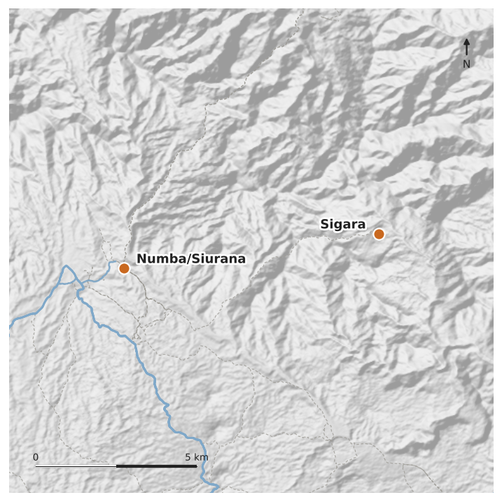
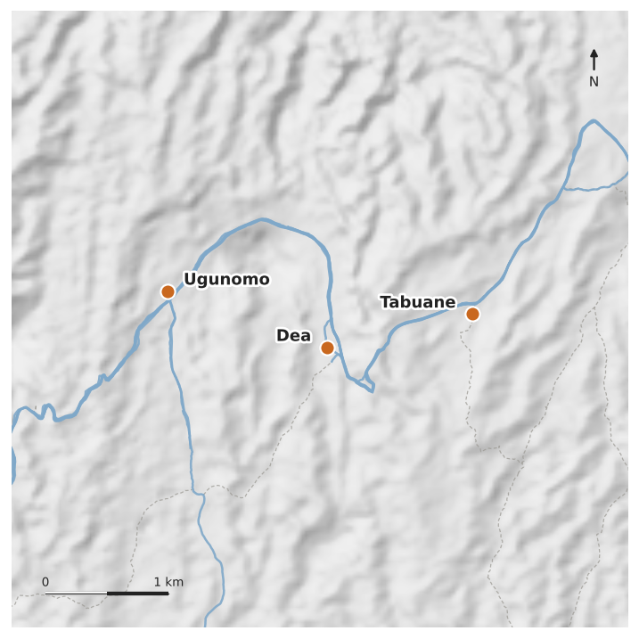
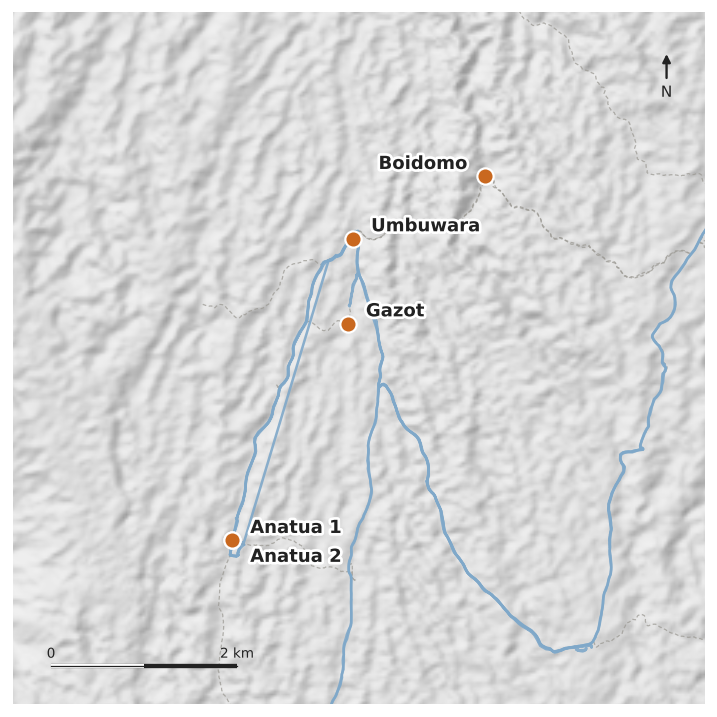

# Questions for Russell

Each page is one ward. The map shows the villages in that ward. Under it is the question. Write the village name on the line, and record the point when you are there.

Where a name says **(approx)** we are not sure exactly where that village is, so the dot is only roughly right. Ask locally.

---

## 05 Siurani

**1. Which village in 05 Siurani has the elementary school?**

Village: ______________________________

---

## 07 Dea

**2. Which village in 07 Dea has the airstrip?**

Village: ______________________________

---

## 10 Gora

**3. Which village in 10 Gora has the elementary school?**

Village: ______________________________

**4. Which village in 10 Gora has the primary school?**

Village: ______________________________

**5. Which village in 10 Gora has the aid post with the CHW house?**

Village: ______________________________

**6. Which village in 10 Gora has the airstrip?**

Village: ______________________________

---

## 12 Umbuwara

**7. Which village in 12 Umbuwara has the aid post?**

Village: ______________________________

---

## 18 Gorobuna

**8. Which village in 18 Gorobuna has the elementary school?**

Village: ______________________________

**9. Which village in 18 Gorobuna has the airstrip?**

Village: ______________________________

---

## 02 Niniuri — Afore Govt Station

**10. We have the CHW houses at Afore. Is there also a Health Centre building, separate from those houses?**

Yes / No: ____________    If yes, record it.

